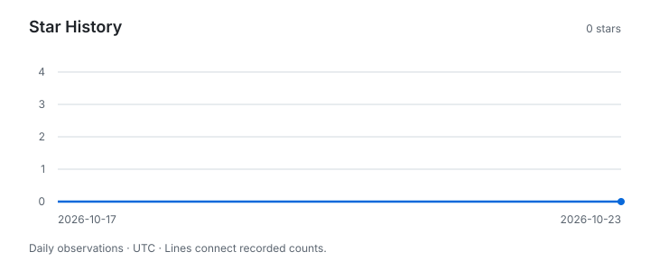

# iLibrary

[](https://github.com/x96x64/ilibrary/releases)
[](https://www.npmjs.com/package/@x96_64/ilibrary)
[](https://pypi.org/project/x96_64-ilibrary/)
[](https://github.com/x96x64/homebrew-tap)
[](https://github.com/x96x64/ilibrary/actions/workflows/ci.yml)
[](LICENSE)
[](#requirements)
[](https://www.swift.org)
[](https://developer.apple.com/documentation/audiotoolbox)
[](#how-it-works)

iLibrary prepares downloaded music for a local Apple Music library and adds it in a controlled order. It converts lossless downloads to Apple Lossless, copies iTunes Store purchases without their purchase metadata, applies metadata from a catalog file without re-encoding, names files as the Music app does, and sets file dates to release dates. It adds albums to Music one at a time and diagnoses differences between files and library records.

```bash
ilibrary apply catalog.json ./staging --dry-run
```

> [!IMPORTANT]
> iLibrary 0.1.0 is experimental. See [Current Status](docs/roadmap-to-stable.md) for publication and verification results. All ten commands are implemented. File processing is verified with synthetic tests, and Music operations use a substitute library in the public suite. The implemented Music commands passed [separate-user validation](docs/reports/library-command-validation.md), and 301 real-file copies passed [copy qualification](docs/reports/library-qualification.md). Follow [Test Library Validation](docs/test-library-validation.md) in a separate macOS user before considering personal-library use. iLibrary is not affiliated with, endorsed by, or sponsored by Apple.

## Contents

- [Features](#features)
- [Requirements](#requirements)
- [Installation](#installation)
- [Quick Start](#quick-start)
- [Usage](#usage)
- [Catalog Format](#catalog-format)
- [How It Works](#how-it-works)
- [Apple Music and Cloud Matching](#apple-music-and-cloud-matching)
- [Troubleshooting](#troubleshooting)
- [Rights and Privacy](#rights-and-privacy)
- [Limitations](#limitations)
- [Documentation](#documentation)
- [Contributing](#contributing)
- [Star History](#star-history)
- [Acknowledgments](#acknowledgments)
- [License](#license)

## Features

- **Ordered addition to Music.** `add` moves each album into the Music media folder, adds it there in place, and confirms one track per file before the next album, in release or artist order. It stops when the library already holds a matching track, never changes a track in Music, and resumes an interrupted run.
- **Lossless import.** `import` converts FLAC, WAV, and AIFF downloads to Apple Lossless through AudioToolbox, verified by decoded PCM equality, and copies iTunes Store files without re-encoding while removing purchase metadata. Standard FLAC tags and the front cover are carried; with `--delete-originals`, originals are moved to the Trash only after every output has been verified.
- **Catalog commands.** `export` drafts a catalog from existing tags, `prompt` prepares it for completion by an AI agent or chat, `validate` checks it and its correspondence with files, and `apply` writes it to the files. Every planned change is listed first; `--dry-run` stops there, and every written file is read back and compared with the plan.
- **Music-style names and release dates.** `apply --rename` arranges files as `Album Artist/Album/NN Title.m4a`, and `timestamps` sets file and folder dates to release dates at local midnight. Missing paths are never created, and symbolic links are refused.
- **MP4 metadata without re-encoding.** `MP4Core` reads and writes the item list of M4A files, rebuilds only the movie box, copies the audio data unchanged, relocates chunk offsets, and replaces items in place, so that repeated application yields identical bytes. Every rewrite goes through a hidden partial file that is parsed again and compared with the source before it replaces the destination.
- **Removal of iTunes Store purchase metadata.** The purchaser's account, name, purchase date, store identifiers, and purchase information are removed, padding is zeroed, and the gapless information is kept. Encrypted files (`.m4p` and `drms` sample entries) are refused.
- **FLAC metadata.** `FLACCore` reads stream information, Vorbis comments, and pictures without decoding audio, and rejects truncated metadata.
- **Catalogs.** `CatalogCore` validates the `ilibrary-catalog-1` format with located diagnostics, and provides matching of files to catalog tracks, Music-style naming, four album orders, title rules, and release-date handling.
- **Checks and diagnostics.** `check` reports missing tags, duplicate tracks, and incorrect dates; `check --library` compares files with Music by location and reports stale metadata, missing files, and notable cloud statuses. `doctor` reports environment problems and recovery steps without launching Music or reading its library.

## Requirements

- macOS 14 or later on Apple silicon
- A Swift 6 toolchain supplied by Xcode or the Command Line Tools for source or Homebrew builds
- npm or Python 3.9 or later for the corresponding package installer; neither is needed by the native executable

The package declares macOS 14 as its deployment target; the current local verification used macOS 27.0.1 and Apple Swift 6.4 on Apple silicon. The minimum OS is not a claim of testing every intervening release. The Core and portable command tests also run on Linux with Swift 6.4. Music commands require the installed Music app and Automation permission. An Apple Music subscription and Apple Account are not required for the public tests or separate-user procedure.

## Installation

The following commands install version 0.1.0. Check [Current Status](docs/roadmap-to-stable.md) for actual availability. Choose one channel. The package names include the author because `ilibrary` on npm and PyPI belongs to other projects.

### Homebrew

```bash
brew install x96x64/tap/ilibrary
```

Homebrew builds from source and requires Swift 6.

### npm

```bash
npm install -g @x96_64/ilibrary@0.1.0
```

### pip

```bash
python3 -m venv .venv-ilibrary
.venv-ilibrary/bin/python -m pip install x96_64-ilibrary==0.1.0
source .venv-ilibrary/bin/activate
```

npm and PyPI install the same native executable. Packages target macOS 14 or later on Apple silicon and are ad hoc-signed; Developer ID signing and notarization are not provided. Run `ilibrary --version` after installation. See [Distribution](docs/distribution.md) and the shared [package README](packaging/README.md).

### From Source

```bash
git clone https://github.com/x96x64/ilibrary.git
cd ilibrary
swift build -c release
export PATH="$PWD/.build/release:$PATH"
ilibrary --version
```

The executable is `.build/release/ilibrary`. The `PATH` line makes it available in the current terminal session; alternatively, invoke it by its full path. No administrator installation is needed. Package installation does not require this source checkout.

### Updating

Use `brew upgrade ilibrary`, `npm update -g @x96_64/ilibrary`, or `python -m pip install --upgrade x96_64-ilibrary` in the selected virtual environment.

In a clean source checkout, run `git pull --ff-only` and rebuild with `swift build -c release`. Review [Current Status](docs/roadmap-to-stable.md) and [CHANGELOG.md](CHANGELOG.md) before adopting a new development commit. If Git reports local changes or divergent history, preserve those changes and resolve them before updating.

### Uninstalling

Use `brew uninstall ilibrary`, `npm uninstall -g @x96_64/ilibrary`, or `python -m pip uninstall x96_64-ilibrary` in the selected environment. For a source build, close the terminal session to discard the temporary `PATH` change. If the executable was copied elsewhere, remove only that copy. iLibrary has no background service. Keep catalogs, artwork, staging files, and `.ilibrary-add.json` journals until their recovery purpose is complete; removing the executable does not undo file or Music changes.

## Quick Start

Begin with copies in a dedicated workspace. The following commands prepare files and do not add them to Music. Replace `./downloads` with the selected copies; keep catalog and artwork together. Review the dry-run output before each write:

```bash
# 1. Convert downloads and copy purchases into a staging folder, after a dry run
ilibrary import ./downloads -o ./staging --dry-run
ilibrary import ./downloads -o ./staging

# 2. Draft a catalog from the files' tags, with their covers
ilibrary export ./staging -o catalog.json --artwork covers --dry-run
ilibrary export ./staging -o catalog.json --artwork covers

# 3. Complete it with an AI agent or chat, or by hand
ilibrary prompt catalog.json > prompt.md

# 4. Validate it, and preview every change
ilibrary validate catalog.json ./staging
ilibrary apply catalog.json ./staging --rename --timestamps --dry-run

# 5. Apply it, then inspect the files
ilibrary apply catalog.json ./staging --rename --timestamps
ilibrary check ./staging
```

For the remaining Music step, use the [separate-user validation procedure](docs/test-library-validation.md). In that test user, preview `ilibrary add ./staging --order release --dry-run` before running without `--dry-run`, then compare the added files with `check --library`. `add` moves selected files out of staging; it retains a progress journal there. See [Library Operations and Recovery](docs/library-operations.md) before resuming an interrupted run.

## Usage

iLibrary is a command-based CLI with verb subcommands. Every mutating command offers `--dry-run`, states what it will change before changing it, and verifies its result afterwards. The [Command-Line Interface](docs/command-line-interface.md) reference describes each command.

```
ilibrary export PATH... -o CATALOG.json [--artwork DIR] [--dry-run]
ilibrary prompt CATALOG.json
ilibrary schema
ilibrary validate CATALOG.json [PATH...]
ilibrary apply CATALOG.json PATH... [--dry-run] [--rename] [--timestamps]
ilibrary import SOURCE... -o DIR [--from mora|itunes|auto] [--delete-originals] [--dry-run]
ilibrary add PATH... [--order release|artist|artist-desc|artist-release] [--dry-run]
ilibrary timestamps CATALOG.json PATH... [--dry-run] [--script FILE]
ilibrary check [PATH...] [--library]
ilibrary doctor
ilibrary help [COMMAND] | --help | --version
```

Exit status is 0 on success, 1 on a failure or a finding from `check` or `doctor`, and 2 on a usage error. `check` requires at least one path or `--library`.

## Catalog Format

A catalog is a UTF-8 JSON document identified by `"format": "ilibrary-catalog-1"`. Album-level values apply to every track and may be overridden per track; an empty string means that a value is unknown. `ilibrary schema` prints the JSON Schema, and [Completing Catalogs with AI Agents](docs/catalog-for-agents.md) describes the authoring workflow.

This excerpt illustrates the structure with "Billie Jean" from Michael Jackson's *Thriller*. It is not a complete album catalog; include every selected track before applying it.

```json
{
  "format": "ilibrary-catalog-1",
  "titleRules": { "case": "keep", "removeQualifiers": ["Remaster"], "bracketNested": true },
  "albums": [
    {
      "album": "Thriller",
      "aliases": ["Thriller (Remastered)"],
      "albumArtist": "Michael Jackson",
      "copyright": "℗ 1982 MJJ Productions, Inc.",
      "releaseDate": "1982-11-30",
      "discs": [
        {
          "tracks": [
            { "title": "Billie Jean", "composer": "Michael Jackson" }
          ]
        }
      ]
    }
  ]
}
```

- **Validation** reports unknown fields, wrong types, missing titles, invalid dates, and duplicate albums with their JSON paths, and rejects documents of other formats. The schema is published as [docs/schema/ilibrary-catalog-1.schema.json](docs/schema/ilibrary-catalog-1.schema.json).
- **Matching** selects the album by name or alias, then the track by disc and track number, by numbering that continues across discs, and by title. A title that disagrees at a file's numbers is treated as a correction only when no other track carries it and more of the album's titles agree than differ; every match and refusal is reported.
- **Naming** follows the Music app: `NN Title.m4a` on single-disc albums, `D-NN Title.m4a` on multi-disc albums, and `_` in place of `:` and `/`.
- **Orders** are `release`, `artist` (albums by name), `artist-desc` (artists and albums descending), and `artist-release` (albums by release date).
- **Title rules** remove listed qualifiers such as `(2012 Remaster)`, write nested parentheticals with square brackets, and apply the MLA, APA, or start-case style. Words whose capitalization depends on their grammatical role are left unchanged and reported.
- **Dates** are written to files as `YYYY-MM-DDT00:00:00Z`; file timestamps use local midnight, or the first instant of the day where a time zone skips midnight.

## How It Works

The package separates domain logic from platform integration, as iLyrics does. No external package or run-time tool is required.

| Target | Contents | Status |
| --- | --- | --- |
| `MP4Core` | Box parsing and rewriting, item lists, chunk offsets, purchase metadata | Implemented; Foundation only |
| `FLACCore` | FLAC metadata blocks | Implemented; Foundation only |
| `CatalogCore` | Catalog format, validation, matching, naming, ordering, title rules, dates | Implemented; Foundation only |
| `ConversionMac` | Conversion to Apple Lossless through AudioToolbox and PCM verification | Implemented; macOS only |
| `LibraryMac` | File dates, Music automation, media folder, permission state | Implemented; macOS only; separate-user commands verified |
| `ilibrary` | Command parsing, plans, and reports | Implemented; Foundation logic with conditional Mac adapters |

The design rests on technical spikes recorded in the [Architecture Spike](docs/reports/architecture-spike.md) report, including measurements on synthetic files and on private copies of purchased and downloaded files.

## Apple Music and Cloud Matching

Albums imported into a library with iCloud Music Library may be identified with albums in the Apple Music catalog, and then shown with that catalog's metadata and artwork. The matching decision belongs to Apple's service. iLibrary removes store identifiers and reports the cloud statuses exposed by Music. The effect of identifier removal on cloud matching has not been measured, and iLibrary does not claim to prevent matching. A local test user without an Apple Account isolates application behavior; it does not measure the cloud service. An `unknown` status is inconclusive.

## Troubleshooting

| Symptom | Next Step |
| --- | --- |
| Music cannot be controlled | Run `doctor` in the intended test user. Follow its Automation permission instructions. |
| A matching track already exists | Stop and inspect the duplicate. iLibrary never removes the existing entry automatically. |
| A run stopped while adding an album | Keep the staging folder and journal. Preview the same `add` command before resuming; see [recovery guidance](docs/library-operations.md#interrupted-addition). |
| A catalog does not match every file | Run `validate` with the selected paths and correct the catalog or selection before applying. |
| `check` reports stale library values | Review the differences. It does not refresh, relink, rename, or delete Music entries. |
| Space is insufficient or a destination exists | Free space or choose a new destination. Do not delete an unverified original to make the command pass. |

See [SUPPORT.md](SUPPORT.md) for a privacy-preserving problem report.

## Rights and Privacy

Use audio and artwork that you are entitled to process. The repository contains synthetic fixtures and no commercial recordings, store artwork, proprietary Apple assets, or private frameworks. iLibrary does not download audio or bypass encryption. Removing purchase metadata is not a guarantee that a file contains no identifying information. Catalogs, prompts, command output, and progress journals may reveal titles, paths, or persistent IDs; review them before sharing. See [Library Operations and Recovery](docs/library-operations.md#privacy-and-reports).

## Limitations

- Live Music validation covers a separate test user on one macOS version; cloud matching remains unmeasured. See [Live Library Command Validation](docs/reports/library-command-validation.md). Catalogs are exported from `.m4a` files only; FLAC tags reach a catalog through `import`.
- Conversion and setting creation dates require macOS. On Linux, the catalog commands and copies by `import` run, but `timestamps` requires `--dry-run`, optionally with `--script`.
- A catalog numbers discs and tracks by position; `export` reports gaps and repetitions in the files' numbers.
- Conversion supports mono and stereo only, and refuses floating-point PCM. FLAC fields outside the standard set are not carried.
- Files that would need chunk offsets beyond 32 bits are refused rather than converted to 64-bit offsets.
- Protected audio (`.m4p`) is out of scope. iLibrary does not download audio.
- Further naming rules of the Music app, such as length limits, are unknown; affected names are reported instead of changed.
- Library comparison covers the file tracks and thirteen fields exposed by the adapter. Artwork, copyright, full release dates, and cloud-only entries not exposed as file tracks are not compared.
- Mutating batches are not transactions: a later failure can leave earlier files or albums completed. Keep backups and the addition journal; no automatic library rollback is attempted.
- Real Trash operations remain untested; public tests use a substitute Trash.

## Documentation

- [Distribution](docs/distribution.md): package names, contents, installation, and publication
- [Library Operations and Recovery](docs/library-operations.md): dry runs, interrupted runs, and privacy
- [Test Library Validation](docs/test-library-validation.md): Japanese instructions and result reporting
- [Technical Planning Study](docs/planning-study.md): the approved plan, preserved as a historical record
- [Command-Line Interface](docs/command-line-interface.md): commands, options, and exit status
- [Completing Catalogs with AI Agents](docs/catalog-for-agents.md): the authoring workflow
- [Roadmap to the Stable Release](docs/roadmap-to-stable.md): current status and decisions in force
- [Catalog JSON Schema](docs/schema/ilibrary-catalog-1.schema.json)
- [Documentation Index](docs/README.md): every engineering report, in chronological order

## Contributing

Read [CONTRIBUTING.md](CONTRIBUTING.md) for build commands, verification, evidence classification, and publication checks, and [AGENTS.md](AGENTS.md) for the engineering constraints. The public test suite uses original synthetic data and needs neither network access, private files, nor a Music library. Commits follow Conventional Commits and preserve human authorship with contribution trailers.

## Star History

<picture>
  <source media="(prefers-color-scheme: dark)" srcset="docs/media/stars/dark.svg">
  
</picture>

Star counts are recorded daily in UTC, beginning on October 17, 2026. Lines connect recorded observations; dates before the first observation and missed observations are not reconstructed. The [recorded counts](docs/media/stars/history.json) include decreases when stars are removed.

## Acknowledgments

iLibrary is developed with [Codex](https://openai.com/codex) by OpenAI and [Claude](https://claude.ai) by Anthropic, credited as co-authors in the commit history.

## License

iLibrary is licensed under the [Apache License, Version 2.0](LICENSE).
